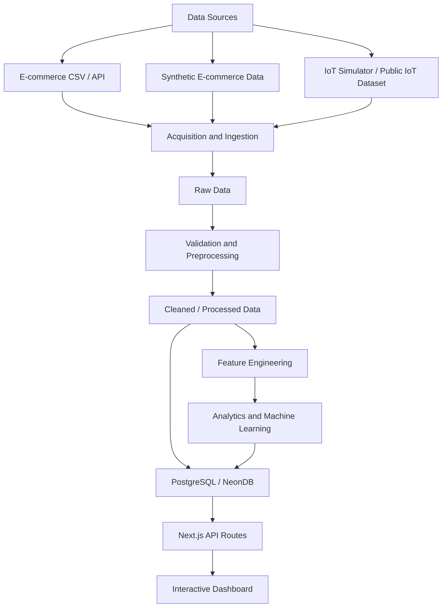

# Merchant Pulse — Architecture

**Version:** 0.2

## 1. Architectural Goals

The architecture must support:

- A complete data pipeline.
- E-commerce and IoT ingestion.
- Large-scale preprocessing and analysis.
- Machine-learning experimentation and evaluation.
- Interactive business dashboards.
- Maintainability by a small academic team.
- Deployment with the selected technology stack.

The architecture should remain as simple as possible without compromising the academic requirements.

## 2. Architecture Style

Use a **modular monolith** for the application, complemented by a Python data-science workspace.

The web application remains one Next.js project with logically separated modules. PostgreSQL is the central persistent database.

Python scripts and notebooks handle data-science workflows that are not appropriate to implement inside request/response web handlers.

This is not a microservices architecture.

## 3. Technology Responsibilities

| Technology           | Responsibility                                 |
| -------------------- | ---------------------------------------------- |
| Next.js Pages Router | Web application and API Routes                 |
| JavaScript           | Application implementation                     |
| React                | Interactive interface                          |
| Tailwind CSS         | Styling                                        |
| Recharts             | Dashboard charts                               |
| Prisma               | Database access and migrations                 |
| PostgreSQL / NeonDB  | Persistent data                                |
| Python               | Data preparation, analysis, and ML             |
| Pandas               | Tabular processing where appropriate           |
| Scikit-learn         | Machine-learning experiments where appropriate |
| Jest                 | JavaScript unit and integration tests          |
| Vercel               | Web application deployment                     |

Python dependencies should be managed independently from the Node.js dependencies.

Do not add a second application backend or GUI framework without a clear requirement. The Next.js dashboard is the primary GUI. Python is the data-science execution environment.

## 4. Logical Architecture



This is a logical flow, not a requirement to store every intermediate dataset in PostgreSQL. Large raw files and intermediate analytical artifacts may remain in a file-based data workspace when appropriate.

## 5. Web Application Modules

Suggested application structure:

```text
src/
  pages/
    index.js
    login.js
    dashboard/
      index.js
      funnel.js
      products/
        index.js
        [id].js
      behavior.js
      iot.js
      machine-learning.js
      settings/
        index.js
        sources.js
        users.js
        targets.js
        stores.js
    api/
      auth/
      analytics/
      imports/
      iot/
      recommendations/
      machine-learning/
  components/
    layout/
    dashboard/
    charts/
    metrics/
    forms/
    ui/
  services/
    auth/
    analytics/
    imports/
    recommendations/
    iot/
    machine-learning/
  lib/
    prisma.js
    validation/
    constants/
  utils/
    dates/
    analytics/
    formatting/
  styles/
```

Python workspace:

```text
data-science/
  README.md
  requirements.txt
  data/
    raw/
    interim/
    processed/
    features/
  notebooks/
  src/
    ingestion/
    preprocessing/
    analysis/
    features/
    models/
    evaluation/
  reports/
  artifacts/
```

Do not commit sensitive datasets, credentials, or large generated artifacts without an explicit repository policy. Document how to obtain or regenerate required data.

## 6. Authentication and Sessions

Dashboard authentication is independent of e-commerce visitor tracking.

Adapt the established PI-II authentication approach to Merchant Pulse, keeping only relevant concepts:

- `User`
- `AuthSession`
- `PasswordResetToken`
- `UserRole`

Suggested roles:

- `ADMIN`
- `MANAGER`
- `ANALYST`

The user belongs to a store in the initial relational model. If cross-store administrators are required, their access model must be explicitly designed rather than assumed.

The authentication session stores a hashed session token, user reference, expiry, and timestamps. Passwords must be stored as secure password hashes, never plaintext.

The PI-II-specific department, process, document, approval, publication, and audit relations are not part of Merchant Pulse unless separately justified.

Do not confuse `AuthSession` with `VisitorSession`:

- `AuthSession` identifies a person logged into the Merchant Pulse dashboard.
- `VisitorSession` represents an anonymized e-commerce browsing session used for analytics.

## 7. Data Acquisition and Ingestion

The ingestion layer accepts data from:

- CSV files.
- APIs, if a suitable source is available.
- Synthetic e-commerce generators.
- IoT simulators or public telemetry datasets.

Each import must be associated with a data source and recorded in the import history.

The pipeline should follow:

1. Receive source data.
2. Identify source format and expected schema.
3. Parse records.
4. Validate required fields and data types.
5. Normalize categories, timestamps, and units.
6. Detect duplicates.
7. Reject or quarantine invalid records.
8. Persist valid records in bounded batches.
9. Record import statistics and errors.

Imports should be idempotent where possible. A retry must not silently duplicate previously imported events.

Use source event IDs or deterministic idempotency keys where available. Do not rely solely on timestamps and values if they cannot uniquely identify a record.

## 8. Large-Scale Processing

Large-scale preprocessing and model training belong in Python workflows, not in ordinary Next.js API requests.

The Python pipeline must:

- Record input and output dataset sizes.
- Use efficient data types.
- Avoid loading unnecessarily large files entirely into memory.
- Use chunk processing or incremental reading when appropriate.
- Document sampling strategies and sampling limitations.
- Preserve reproducibility through configuration and random seeds.
- Save processing metadata and experiment results.

Sampling is not automatically required. Use the complete dataset when practical. If sampling is necessary, explain how it was performed and whether it preserves the distributions and patterns relevant to the analysis.

The final dataset may be stored in PostgreSQL for application queries while raw and intermediate analytical files remain in the Python workspace.

## 9. Preprocessing and Statistical Analysis

Preprocessing must be explicit and reproducible.

Each dataset should have a data dictionary containing:

- Variable name.
- Description.
- Data type.
- Measurement scale.
- Allowed values or units.
- Missing-value policy.
- Transformation applied.
- Analytical role.

Categorical codes must remain categorical. For example, `0 = mobile`, `1 = desktop`, and `2 = tablet` must not be averaged as if they represented a numeric measurement.

Outlier handling must be justified. Retain meaningful extreme events unless there is evidence that they are corrupted.

## 10. Machine-Learning Workflow

Machine learning is a mandatory project deliverable.

The workflow:

1. Define the problem and target.
2. Select a suitable dataset.
3. Define the observation unit.
4. Prevent target leakage.
5. Prepare features.
6. Establish a baseline.
7. Split data into training, validation, and test sets.
8. Train candidate models.
9. Evaluate generalization.
10. Compare results and document limitations.
11. Save model metadata and reproducible artifacts.
12. Expose relevant results in the dashboard.

For time-dependent data, use a chronological split where appropriate. Do not randomly mix future information into training when the real use case predicts future behavior.

Use training and validation performance to investigate overfitting and underfitting.

Metrics must match the task:

- Regression: MAE, RMSE, optionally R².
- Classification: precision, recall, F1-score, confusion matrix, and suitable ranking metrics.
- Clustering: justified internal or external clustering evaluation, where applicable.

The dashboard must clearly distinguish model performance metrics from business KPIs.

## 11. IoT Architecture

IoT ingestion is independent from e-commerce events and orders.

The simulator or public data source generates timestamped measurements. The ingestion endpoint or batch importer validates and persists them in dedicated telemetry structures.

A telemetry record should identify:

- Store or owning context, when applicable.
- Device or source.
- Measurement type.
- Numeric value.
- Unit.
- Measurement timestamp.
- Ingestion timestamp.
- Data-quality or validation status, where needed.
- Import/source reference.

The final measurement types and their analytical purpose remain open.

The simulator must produce plausible time-series data with documented generation rules. It must not merely populate charts with hardcoded display values.

## 12. Analytics and Recommendations

Business calculations must live in centralized services or parameterized analytical queries.

React components should not implement business formulas.

API Routes should validate inputs, enforce access rules, call services, and return prepared results.

Rule-based recommendations must be explainable and traceable to:

- The rule identifier.
- The metric evaluated.
- The target or threshold.
- The relevant period.
- The affected store or product.
- The suggested action.

Recommendations are not machine-learning predictions.

## 13. Interactive Dashboard

The dashboard must support dynamic interaction.

Global filters should include:

- Store.
- Date range.
- Category where relevant.

Page-specific filters may include:

- Device.
- Traffic source.
- Product.
- IoT device or telemetry source.
- Measurement type.
- ML model or prediction parameters.

The charts must update from actual query results based on active filters.

Suggested visualizations include:

- KPI cards.
- Funnel charts.
- Time-series charts.
- Product/category rankings.
- Heatmaps for day and hour.
- Box plots for distributions and outliers.
- Scatter plots for relationships.
- Correlation heatmaps where statistically justified.
- Model evaluation charts and confusion matrices.

Do not add advanced plots solely for appearance. Each visualization must answer a defined analytical question.

## 14. Database and Prisma

Prisma is the standard ORM.

Use a centralized Prisma client and migrations for schema changes.

Use raw SQL selectively for analytical aggregations, PostgreSQL-specific features, or queries that Prisma cannot express efficiently.

Database constraints and indexes must reflect actual query patterns.

The collaborator's SQL includes PostgreSQL views and functions. These may be implemented through SQL migration files where useful. Do not assume every view or generated column can be represented directly in the Prisma schema.

Prefer parameterized queries and test analytical queries with representative data volumes.

## 15. Deployment

The Next.js application is deployed on Vercel and uses NeonDB.

Vercel functions are request-oriented and must not be treated as permanent background workers.

Large imports and model training should not be executed as unbounded work inside a dashboard request. They belong in bounded scripts or an explicitly designed execution process.

The deployment plan must document where Python processing and model artifacts execute and how the web application accesses the resulting data.

## 16. Architectural Restrictions

Do not introduce without justification:

- Microservices.
- Express or a second web backend.
- Redis.
- Message brokers.
- Permanent workers.
- Complex state-management frameworks.
- Full inventory-management workflows.
- Physical IoT hardware as a requirement.
- A second dashboard framework duplicating the Next.js GUI.

Keep the architecture modular, testable, and appropriate for a small academic team.
