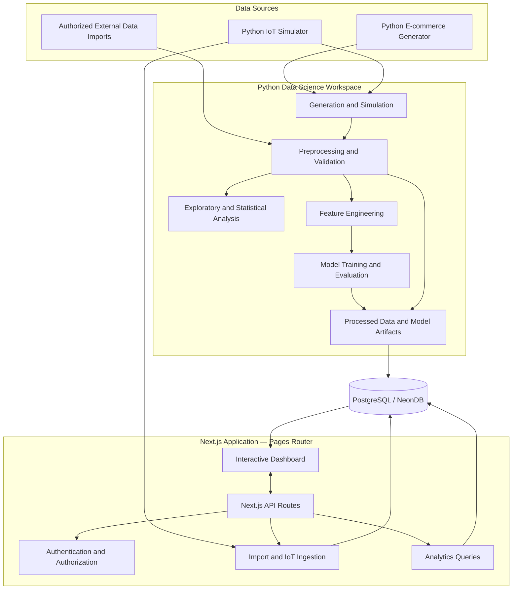
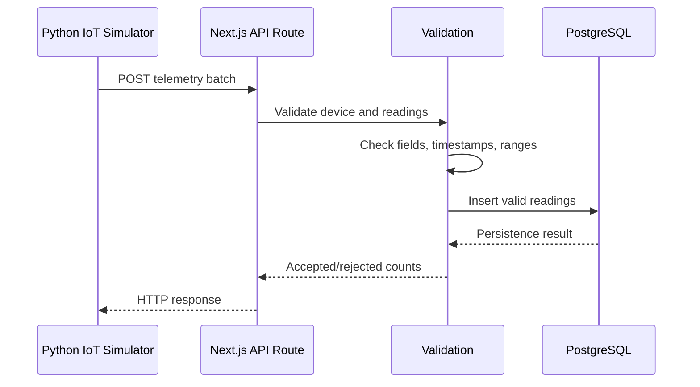
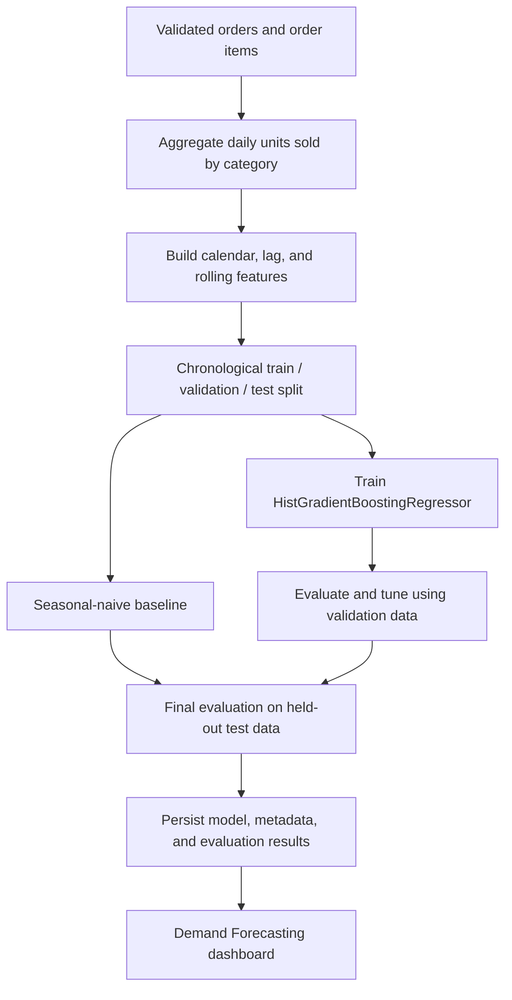

# Merchant Pulse — Architecture

**Version:** 0.3

## 1. Architectural goals

Merchant Pulse uses a modular monolith architecture with a separate Python data-science workspace.

The architecture is designed to:

- Keep the web application straightforward to develop and deploy.
- Separate application concerns from data-science workflows.
- Support reproducible data generation and processing.
- Persist analytical source data and telemetry in PostgreSQL.
- Provide interactive analytics through a web interface.
- Avoid unnecessary infrastructure and operational complexity.

The initial release does not require microservices, Kafka, Redis, MQTT brokers, permanent background workers, or a separate Express server.

## 2. High-level architecture



The Python workspace performs data-science operations. The Next.js application handles user interaction, authentication, API requests, persistence access, and presentation.

## 3. Technology stack

### Web application

| Technology           | Responsibility                        |
| -------------------- | ------------------------------------- |
| JavaScript           | Application language                  |
| Next.js Pages Router | Web application and API routes        |
| React                | Interface components                  |
| Tailwind CSS         | Styling and responsive layout         |
| Recharts             | Interactive analytical charts         |
| Prisma ORM           | Database access and schema management |
| PostgreSQL           | Persistent relational storage         |
| NeonDB               | Managed PostgreSQL hosting            |
| Vercel               | Application deployment                |

### Data science

| Technology   | Responsibility                             |
| ------------ | ------------------------------------------ |
| Python       | Data-science workflows                     |
| Pandas       | Tabular preprocessing and analysis         |
| NumPy        | Numerical operations                       |
| scikit-learn | Regression model and evaluation            |
| CSV          | Interchange and initial generated datasets |
| Parquet      | Optional efficient analytical storage      |

### Testing

- Jest for JavaScript modules, API routes, and application behavior.
- Python tests for generation, preprocessing, feature engineering, and model evaluation.

## 4. Application organization

The Next.js application follows a feature-oriented organization.

```text
src/
├── components/
│   ├── layout/
│   ├── charts/
│   ├── filters/
│   └── ui/
├── features/
│   ├── overview/
│   ├── funnel/
│   ├── products/
│   ├── behavior/
│   ├── data-pipeline/
│   ├── iot/
│   ├── forecasting/
│   └── settings/
├── lib/
│   ├── auth/
│   ├── db/
│   ├── validation/
│   ├── analytics/
│   └── exports/
├── pages/
│   ├── api/
│   └── ...
└── styles/
```

The exact component and route names may evolve, but feature-specific business logic should remain grouped by domain.

### Responsibilities

**Presentation layer**

- Renders dashboard pages and reusable components.
- Manages local interface state, filters, and chart interactions.
- Displays loading, empty, success, and error states.
- Does not contain authoritative business calculations.

**API layer**

- Receives client requests.
- Authenticates users where required.
- Validates input.
- Applies authorization and store scope.
- Calls domain and analytics functions.
- Returns structured responses.

**Domain and analytics layer**

- Defines funnel, revenue, and product-performance calculations.
- Encapsulates business rules.
- Applies consistent date and status semantics.
- Avoids duplicating formulas across pages.

**Persistence layer**

- Uses Prisma for ordinary relational operations.
- Uses carefully parameterized SQL for analytical queries when necessary.
- Keeps schema and migration history under version control.

## 5. Python workspace

```text
data-science/
├── generators/
│   ├── ecommerce_generator.py
│   └── generation_config.py
├── simulators/
│   ├── warehouse_iot_simulator.py
│   └── telemetry_config.py
├── preprocessing/
│   ├── validation.py
│   ├── cleaning.py
│   └── quality_report.py
├── analysis/
│   ├── descriptive.py
│   ├── funnel.py
│   └── exploratory.py
├── features/
│   └── demand_features.py
├── models/
│   ├── baseline.py
│   └── demand_model.py
├── evaluation/
│   └── metrics.py
├── notebooks/
└── tests/
```

Python scripts must be executable independently and should expose clear configuration parameters.

The generator and simulator should not depend on the Next.js application to produce their source data. Ingestion into the application is a separate operation.

## 6. E-commerce data flow

1. The generator creates products, sessions, events, orders, and order items.
2. Generated data is written in batches to CSV or Parquet.
3. The preprocessing pipeline validates structure and content.
4. Invalid records are rejected or corrected according to documented rules.
5. Duplicate records are removed using stable deduplication keys.
6. Quality reports record accepted, rejected, corrected, and deduplicated counts.
7. Validated data is loaded into PostgreSQL.
8. The application queries the stored data through analytics functions.
9. Dashboard components display the results using interactive charts and tables.

### Generator characteristics

The generator must:

- Use a configurable fixed seed.
- Support configurable start and end dates.
- Generate consistent product, session, event, and order relationships.
- Produce plausible purchase journeys and non-conversions.
- Generate seasonality, promotion effects, and varying demand.
- Support batch output.
- Avoid generating unrelated record collections that do not reference one another.

Indicative initial scale:

| Entity            |        Initial target |
| ----------------- | --------------------: |
| Products          |               100–200 |
| Visitor sessions  |       300,000–500,000 |
| Navigation events |           2–5 million |
| Orders            |        50,000–100,000 |
| Activity period   | Approximately 2 years |

The values are targets for benchmarking. They are not hard constraints and must be reconciled with the generated relationships.

## 7. IoT ingestion flow

The IoT simulator generates timestamped measurements and sends them to a Next.js API route over HTTP.



### Initial simulation

- 10 devices.
- Five-minute interval.
- 180 days.
- 518,400 readings.
- Temperature, relative humidity, and energy consumption.

The simulator may send readings individually or in batches. The API must impose a reasonable payload limit and validate every measurement.

A duplicate device/timestamp/measurement combination must not create duplicate telemetry.

### Why HTTP instead of a message broker?

The initial project needs a demonstrable ingestion path, not a production-scale streaming platform. HTTP is sufficient to demonstrate device simulation, validation, ingestion, persistence, and visualization.

MQTT, Kafka, Redis, or other infrastructure may be evaluated later only if a documented requirement justifies it.

## 8. Data processing and memory management

Large datasets must be handled deliberately.

- Generate data in batches rather than building the entire dataset in memory.
- Use chunked file reading for large CSV inputs.
- Select only the columns needed for a processing step.
- Prefer appropriate numeric and categorical data types.
- Avoid unnecessary copies of large DataFrames.
- Use database-side aggregation when it reduces data transfer and memory use.
- Consider Parquet for intermediate data where it improves storage and processing.
- Record representative execution time and memory consumption.

If sampling is used for exploratory analysis or model development, document the selection method, sample size, and reason. Preserve a distinction between sample-based findings and full-dataset results.

## 9. Machine-learning workflow

The machine-learning pipeline is independent from the interactive dashboard.



### Target

Daily units sold per product category.

### Candidate features

- Category.
- Day of week.
- Month.
- Weekend indicator.
- Promotion indicator.
- Lagged sales at 1, 7, and 14 days.
- Rolling means at 7 and 28 days.

Feature generation must be time-aware. Rolling windows and lag features must not use future observations.

### Models

- Baseline: same weekday from the previous week.
- Main candidate: `HistGradientBoostingRegressor`.

### Evaluation

Use a chronological 70% / 15% / 15% split for training, validation, and testing. Compare MAE, RMSE, and R² against the baseline.

Persist enough metadata to identify:

- Model name and version.
- Training data date range.
- Feature definitions.
- Split boundaries.
- Evaluation metrics.
- Training configuration.

The application must not report evaluation metrics that have not actually been computed.

## 10. Analytics definitions and query responsibilities

The main analytical calculations should be centralized.

### Funnel

- Count distinct visitor sessions at each stage.
- Count a stage at most once per session.
- Enforce chronological stage progression.
- Attribute the session to its start date.
- Do not substitute raw event counts for session counts.

### Revenue

- Include only paid, shipped, and delivered orders.
- Exclude pending, cancelled, and returned orders.
- Attribute revenue to the order creation date.
- Keep revenue and funnel session conversion as separate measures.

### Product performance

- Navigation metrics may use events.
- Sales and revenue metrics must use eligible orders and their items.
- Product rankings must respect the selected period and store.
- Do not imply stock-management functionality.

### Timezone

The initial store timezone is `America/Sao_Paulo`. Store timestamps consistently and apply the configured timezone when grouping and displaying business dates.

## 11. Authentication and authorization architecture

Authentication is for dashboard users only. It must not share tables or identifiers with visitor tracking.

The authentication design is adapted from the PI-II implementation:

- `User` stores identity, password hash, role, activity state, and timestamps.
- `Session` stores a session identifier, token hash, user reference, expiration, and timestamps.
- `PasswordResetToken` stores a reset token, user reference, expiration, and usage state.

Only the token hash is stored for active sessions. The raw session token is delivered to the client through a secure cookie.

Roles:

- `ADMIN`
- `MANAGER`
- `ANALYST`

Authorization must be enforced in API routes and server-side domain operations. The frontend is not the security boundary.

## 12. Deployment

The web application is deployed to Vercel. PostgreSQL is hosted by NeonDB.

Python data-science tasks are executed as explicit scripts or controlled development/processing jobs. They are not assumed to run continuously inside Vercel functions.

The initial architecture does not require a dedicated Python web server. If a later implementation requires online model inference, first evaluate whether precomputed forecasts and stored model outputs satisfy the requirement. Introduce a separate inference service only when there is a clear technical need.

### Environment configuration

Keep secrets and database URLs in environment variables. Never commit credentials or tokens.

Use separate development and test database configurations. Production migrations must be deliberate and reviewed.

## 13. Security and privacy

- Validate all API input.
- Enforce authentication and role permissions server-side.
- Enforce store scope in queries.
- Hash passwords with an appropriate password-hashing algorithm.
- Store hashes of session tokens and reset tokens.
- Use secure cookie settings in production.
- Avoid logging secrets or consumer identifiers.
- Exclude consumer personal information from exports.
- Treat pseudonymous identifiers as protected data.
- Limit telemetry ingestion payload sizes.
- Prevent duplicate ingestion.

## 14. Architectural constraints

The following constraints apply to the initial implementation:

- One Next.js application.
- Pages Router.
- JavaScript.
- One PostgreSQL database.
- Prisma for relational persistence.
- Python for data-science workflows.
- No microservices by default.
- No permanent worker infrastructure by default.
- No unnecessary state-management dependency.
- No inventory-management module.
- No physical sensor requirement.
- No claim that synthetic data represents actual company transactions.

Any architectural expansion must be justified by a functional, academic, or measurable performance requirement.
