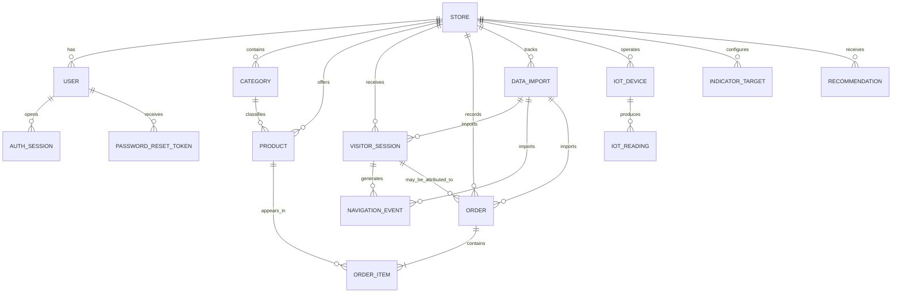

# Merchant Pulse — Data Model

**Version:** 0.3  
**Database:** PostgreSQL  
**ORM:** Prisma

## 1. Modeling principles

The data model supports four distinct concerns:

1. Dashboard users and authentication.
2. E-commerce catalog, visitor sessions, navigation events, and orders.
3. Data imports and processing traceability.
4. Simulated IoT devices and telemetry.

The model is designed for an initial single-store demonstration while retaining a simple `Store` relationship. It does not implement a complex multi-tenant SaaS architecture.

The model must distinguish visitor behavior from dashboard authentication. These are different domains and must never share the same session table.

## 2. Entity overview



The diagram represents logical relationships. Optional relationships, uniqueness rules, and exact foreign-key behavior must be reflected in the Prisma schema.

## 3. Enumerations

Suggested Prisma enums:

```prisma
enum UserRole {
  ADMIN
  MANAGER
  ANALYST
}

enum EventType {
  VISIT
  PRODUCT_VIEW
  CART_ADD
  CHECKOUT_START
  ORDER_COMPLETED
}

enum OrderStatus {
  PENDING
  PAID
  SHIPPED
  DELIVERED
  CANCELLED
  RETURNED
}

enum ImportStatus {
  IN_PROGRESS
  COMPLETED
  ERROR
}

enum DataSourceType {
  CSV
  API
  SYNTHETIC
}

enum DeviceStatus {
  ACTIVE
  INACTIVE
}

enum MeasurementType {
  TEMPERATURE
  HUMIDITY
  ENERGY
}

enum RecommendationPriority {
  LOW
  MEDIUM
  HIGH
  CRITICAL
}
```

Persisted enum values should be stable. Changes to their names or meanings require migrations and updates to application logic.

## 4. Core entities

### 4.1 Store

Represents the e-commerce operation whose data is analyzed.

Suggested fields:

| Field     | Type     | Notes                           |
| --------- | -------- | ------------------------------- |
| id        | UUID     | Primary key                     |
| name      | String   | Store display name              |
| timezone  | String   | Defaults to `America/Sao_Paulo` |
| isActive  | Boolean  | Store availability              |
| createdAt | DateTime | Creation timestamp              |
| updatedAt | DateTime | Last update                     |

The first deployment uses one demonstration store.

Every store-owned analytical entity must be scoped to its store. Store identifiers must be derived from the authenticated user's authorization context, not trusted blindly from client input.

### 4.2 User

Represents a dashboard user.

| Field        | Type     | Notes                           |
| ------------ | -------- | ------------------------------- |
| id           | UUID     | Primary key                     |
| storeId      | UUID     | Store relationship              |
| name         | String   | Display name                    |
| email        | String   | Unique login identifier         |
| passwordHash | String   | Never store plaintext passwords |
| role         | UserRole | ADMIN, MANAGER, ANALYST         |
| isActive     | Boolean  | Allows account deactivation     |
| createdAt    | DateTime | Creation timestamp              |
| updatedAt    | DateTime | Last update                     |

The authentication model is adapted from PI-II. Domain-specific fields and relationships from that project must not be carried over.

### 4.3 AuthSession

Represents an authenticated dashboard session.

Suggested fields:

| Field     | Type     | Notes                            |
| --------- | -------- | -------------------------------- |
| sessionId | UUID     | Primary key                      |
| tokenHash | String   | Unique hash of raw session token |
| userId    | UUID     | Dashboard user                   |
| expiresAt | DateTime | Session expiration               |
| createdAt | DateTime | Creation timestamp               |
| updatedAt | DateTime | Last update                      |

Indexes:

- Unique index on `tokenHash`.
- Index on `userId`.
- Index on `expiresAt`.
- Composite index on `userId` and `expiresAt`.

The raw session token must never be persisted. It should be sent to the client only through the configured secure cookie mechanism.

### 4.4 PasswordResetToken

Represents a password-reset request.

Suggested fields:

| Field     | Type      | Notes               |
| --------- | --------- | ------------------- |
| id        | UUID      | Primary key         |
| tokenHash | String    | Unique token hash   |
| userId    | UUID      | User reference      |
| expiresAt | DateTime  | Expiration          |
| usedAt    | DateTime? | Null until consumed |
| createdAt | DateTime  | Creation timestamp  |

The reset token must be single-use and expire. Store a hash rather than the raw token.

### 4.5 Category

Represents a product category.

| Field       | Type     | Notes                |
| ----------- | -------- | -------------------- |
| id          | UUID     | Primary key          |
| storeId     | UUID     | Store relationship   |
| name        | String   | Category name        |
| description | String?  | Optional description |
| createdAt   | DateTime | Creation timestamp   |
| updatedAt   | DateTime | Last update          |

Category names are nominal categorical values. They must not be used as numerical measurements.

### 4.6 Product

Represents a product in the analyzed catalog.

| Field         | Type     | Notes                               |
| ------------- | -------- | ----------------------------------- |
| id            | UUID     | Primary key                         |
| storeId       | UUID     | Store relationship                  |
| categoryId    | UUID     | Category relationship               |
| sku           | String   | Store-scoped product code           |
| name          | String   | Product name                        |
| price         | Decimal  | Product price                       |
| isActive      | Boolean  | Product availability in the catalog |
| stockSnapshot | Int?     | Optional read-only imported value   |
| createdAt     | DateTime | Creation timestamp                  |
| updatedAt     | DateTime | Last update                         |

A uniqueness constraint should prevent duplicate SKUs within the same store.

Stock values, if present, are historical or imported snapshots only. Merchant Pulse does not provide inventory operations.

### 4.7 VisitorSession

Represents an anonymous or pseudonymous e-commerce visitor session.

It is not an authentication session.

| Field         | Type     | Notes                                               |
| ------------- | -------- | --------------------------------------------------- |
| id            | UUID     | Internal primary key                                |
| storeId       | UUID     | Store relationship                                  |
| sessionHash   | String   | Pseudonymous external session identifier            |
| customerHash  | String?  | Optional pseudonymous returning-customer identifier |
| startedAt     | DateTime | Session start                                       |
| deviceType    | String?  | Device classification                               |
| trafficSource | String?  | Acquisition source                                  |
| stateCode     | String?  | Optional Brazilian state code                       |
| dataImportId  | UUID?    | Import provenance                                   |
| createdAt     | DateTime | Record creation                                     |

Deduplication should use the store and stable external session identifier. If multiple source systems are supported, include the source identity in the uniqueness key.

Do not store consumer names, emails, phone numbers, or full addresses.

Hashing is pseudonymization, not proof of anonymization.

### 4.8 NavigationEvent

Represents a navigation or purchase-journey event.

| Field            | Type      | Notes                                   |
| ---------------- | --------- | --------------------------------------- |
| id               | UUID      | Primary key                             |
| storeId          | UUID      | Store relationship                      |
| visitorSessionId | UUID      | Visitor session                         |
| productId        | UUID?     | Optional product                        |
| eventType        | EventType | Five-stage event taxonomy               |
| occurredAt       | DateTime  | Event timestamp                         |
| sourceEventId    | String?   | External event identifier               |
| fingerprint      | String?   | Deterministic deduplication fingerprint |
| dataImportId     | UUID?     | Import provenance                       |
| createdAt        | DateTime  | Record creation                         |

The event taxonomy is:

- `VISIT`
- `PRODUCT_VIEW`
- `CART_ADD`
- `CHECKOUT_START`
- `ORDER_COMPLETED`

A session may generate multiple events of the same type. Funnel aggregation must count a session only once per stage.

When an external event ID exists, use it for deduplication within its source scope. Otherwise, use a deterministic fingerprint based on the session, event type, timestamp, product, and source context as appropriate.

### 4.9 Order

Represents a transaction recorded by the e-commerce source.

| Field            | Type        | Notes                               |
| ---------------- | ----------- | ----------------------------------- |
| id               | UUID        | Primary key                         |
| storeId          | UUID        | Store relationship                  |
| visitorSessionId | UUID?       | Optional session attribution        |
| externalOrderId  | String?     | Source order identifier             |
| status           | OrderStatus | Transaction status                  |
| createdAt        | DateTime    | Order creation timestamp            |
| subtotal         | Decimal     | Sum of item values before discounts |
| discountAmount   | Decimal     | Discount amount                     |
| shippingAmount   | Decimal     | Shipping amount                     |
| totalAmount      | Decimal     | Final order total                   |
| dataImportId     | UUID?       | Import provenance                   |

A uniqueness constraint should prevent duplicate external orders within the same store and source scope.

The order total must be validated against its components. The permitted relationship is:

`totalAmount = subtotal - discountAmount + shippingAmount`

The database or ingestion layer must reject invalid negative amounts and discounts exceeding the applicable subtotal.

### 4.10 OrderItem

Represents a product line within an order.

| Field          | Type    | Notes                        |
| -------------- | ------- | ---------------------------- |
| id             | UUID    | Primary key                  |
| orderId        | UUID    | Order relationship           |
| productId      | UUID    | Product relationship         |
| quantity       | Int     | Number of units              |
| unitPrice      | Decimal | Price at order time          |
| discountAmount | Decimal | Line-level discount, if used |
| lineTotal      | Decimal | Final line total             |

An explicit primary key is preferred when the source can contain multiple lines for the same product, such as separate variants or distinct discounts.

The unit price should be retained as a transaction snapshot. Product catalog price may change after an order is created.

### 4.11 DataSource

Represents the origin or configuration of an imported dataset.

Suggested fields:

- id
- storeId
- name
- type (`CSV`, `API`, `SYNTHETIC`)
- configuration metadata where safe
- createdAt
- updatedAt

Do not store secrets in unencrypted configuration metadata.

### 4.12 DataImport

Represents an import or processing run.

Suggested fields:

- id
- storeId
- dataSourceId
- status
- startedAt
- completedAt
- recordsRead
- recordsAccepted
- recordsRejected
- recordsCorrected
- duplicatesRemoved
- errorSummary
- metadata

Each import should be traceable to its source and processing result.

Re-running the same import must not create duplicate sessions, events, or orders when stable source identifiers are available.

## 5. IoT entities

IoT telemetry is a separate domain. It must not be inserted into the e-commerce `NavigationEvent` table.

### 5.1 IoTDevice

Represents a simulated warehouse monitoring device.

Suggested fields:

- id
- storeId
- deviceCode
- name
- status
- locationLabel
- createdAt
- updatedAt

`deviceCode` must be unique within a store.

### 5.2 IoTReading

Represents a measurement produced by a device.

Suggested fields:

- id
- deviceId
- measurementType
- measuredAt
- numericValue
- receivedAt
- sourceFingerprint

Measurements:

- `TEMPERATURE`, unit °C.
- `HUMIDITY`, unit %.
- `ENERGY`, unit kW.

For a design with one row per device and timestamp containing all measurements, the schema may instead store temperature, humidity, and energy as separate nullable numeric columns. The implementation must choose one consistent representation and document it.

The normalized measurement-type design is flexible for adding new measurement types. The single-row design may be more convenient for the fixed three-measurement simulator.

Uniqueness should prevent duplicate measurements for the same device, timestamp, and measurement type.

## 6. Analytical configuration entities

### 6.1 IndicatorTarget

Stores configurable targets or thresholds for dashboard indicators.

Suggested fields:

- id
- storeId
- indicatorKey
- targetValue
- warningThreshold
- criticalThreshold
- createdAt
- updatedAt

The indicator key must identify a documented metric. Thresholds must have a defined comparison direction and unit.

### 6.2 Recommendation

Stores rule-based recommendations shown in the dashboard.

Suggested fields:

- id
- storeId
- indicatorKey
- title
- description
- priority
- observedValue
- targetValue
- generatedAt
- status or dismissal state, if needed

Recommendations are generated from documented rules and metric deviations. They must not be described as machine-learning predictions unless a model actually generates them.

## 7. Funnel semantics

The funnel is session-based.

For each session:

1. Identify the visit stage.
2. Identify whether the session reached product view.
3. Identify whether the session reached cart addition.
4. Identify whether the session reached checkout initiation.
5. Identify whether the session reached completed order.

Each stage is counted at most once per session.

Events must be ordered chronologically. A session cannot be counted at a later stage without satisfying the required preceding stages under the project's funnel definition.

The primary funnel date is the visitor session start date. This is a cohort attribution rule, not the date of every individual event.

### Conversion caveat

One session may generate multiple orders. A completed order is therefore not automatically equivalent to one converted session.

If an order is explicitly attributed to a visitor session, the funnel can count that session as converted once. If attribution is missing, the system must report order counts and session conversion separately.

## 8. Revenue semantics

Only orders with status:

- `PAID`
- `SHIPPED`
- `DELIVERED`

contribute to recognized revenue.

Exclude:

- `PENDING`
- `CANCELLED`
- `RETURNED`

Revenue is attributed to the order creation date in the store timezone.

Average order value:

`recognized revenue / eligible order count`

Revenue per product must be calculated from eligible order items, not from product navigation events.

The precise inclusion of shipping and discounts must remain consistent with the documented `totalAmount` definition.

## 9. Demand forecasting dataset

The model-training dataset is derived from eligible order items.

Processing steps:

1. Filter orders to eligible revenue statuses.
2. Join order items to products and categories.
3. Aggregate quantity by business date and category.
4. Build a complete daily category time series where required.
5. Create calendar, promotion, lag, and rolling features.
6. Exclude rows without the required historical information.
7. Split chronologically into training, validation, and test periods.

Target:

`daily_units_sold`

Candidate features:

- category identifier, treated as categorical;
- day of week;
- month;
- weekend indicator;
- promotion indicator;
- sales lags at 1, 7, and 14 days;
- rolling means at 7 and 28 days.

All features must be available at the prediction time. No future sales may contribute to lag or rolling features.

Model artifacts and evaluation metadata should be stored separately from transactional source records. The initial implementation may store model metadata and precomputed forecasts in the database or as versioned artifacts, depending on the integration design.

## 10. Variable classification

| Variable                | Measurement type           | Notes                                    |
| ----------------------- | -------------------------- | ---------------------------------------- |
| Product category        | Qualitative nominal        | Frequencies and proportions              |
| Device type             | Qualitative nominal        | Frequencies and proportions              |
| Traffic source          | Qualitative nominal        | Frequencies and proportions              |
| Order status            | Qualitative nominal        | Frequencies and proportions              |
| User role               | Qualitative nominal        | Frequencies and proportions              |
| Recommendation priority | Qualitative ordinal        | Ordered categories                       |
| Temperature             | Quantitative interval-like | Numeric summaries                        |
| Humidity                | Quantitative ratio         | Numeric summaries                        |
| Energy consumption      | Quantitative ratio         | Numeric summaries                        |
| Units sold              | Quantitative ratio         | Numeric summaries                        |
| Revenue                 | Quantitative ratio         | Numeric summaries                        |
| Session duration        | Quantitative ratio         | Numeric summaries                        |
| Timestamps              | Temporal                   | Time-based grouping and intervals        |
| IDs and hashes          | Identifiers                | Never summarize as continuous quantities |

## 11. Deduplication and integrity

Recommended deduplication keys:

| Entity           | Key                                          |
| ---------------- | -------------------------------------------- |
| Product          | Store + SKU                                  |
| Visitor session  | Store + source + external session ID         |
| Navigation event | Source event ID or deterministic fingerprint |
| Order            | Store + source + external order ID           |
| IoT device       | Store + device code                          |
| IoT reading      | Device + timestamp + measurement type        |

When source identifiers are unavailable, the fingerprint algorithm must be deterministic and documented.

Use database constraints for uniqueness and referential integrity wherever practical. Application-level validation alone is insufficient for critical uniqueness rules.

## 12. Indexing considerations

Initial indexes should support:

- Store-scoped product and category lookups.
- Visitor sessions by store and start time.
- Navigation events by session, type, and occurrence time.
- Orders by store, status, and creation time.
- Order items by order and product.
- Imports by store and creation time.
- IoT readings by device and measurement timestamp.
- Authentication sessions by token hash, user, and expiration.

Index design should be revisited using actual query plans and representative data volumes. Avoid creating indexes without a query or integrity requirement.

## 13. Data retention and privacy

- Do not store consumer direct identifiers.
- Use pseudonymous hashes where visitor linkage is required.
- Restrict access to raw visitor-level data.
- Use aggregated results for dashboard presentation whenever possible.
- Exclude consumer personal information from exports.
- Define retention for imports, telemetry, and visitor records.
- Do not claim hashes guarantee anonymization.

## 14. Implementation notes

The collaborator's proposed SQL schema is a starting point, not an immutable contract. The Prisma model must reflect the semantics defined in this document.

The initial implementation should avoid unnecessary dimensional tables or materialized views. A calendar dimension may be introduced if it materially improves the analytical workflow. Otherwise, PostgreSQL date operations are sufficient.

Analytical queries must support the selected date range and store scope. Fixed-period views should not be used where the dashboard requires dynamic filters.
