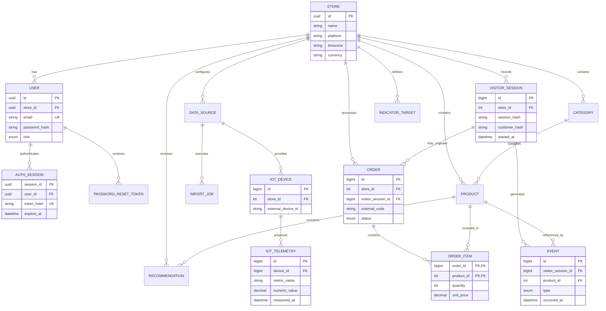

# Merchant Pulse — Data Model

**Version:** 0.2  
**Database:** PostgreSQL 14+

## 1. Modeling Principles

The relational model is based on the collaborator's proposed PostgreSQL schema, adapted to the project's architecture and academic requirements.

The model supports:

- Multiple stores.
- Dashboard authentication.
- Product and category catalogs.
- E-commerce visitor sessions and events.
- Orders and order items.
- Data sources and import history.
- Independent IoT telemetry.
- Business recommendations and indicator targets.
- Machine-learning experiment traceability.

The initial demonstration may contain only one store. The model should not require a complex multi-tenant infrastructure.

All consumer analytical identifiers must be pseudonymous. Dashboard users are separate entities.

## 2. Important Naming Distinction

There are two different session concepts:

- `AuthSession`: authenticated session for a Merchant Pulse dashboard user.
- `VisitorSession`: anonymized e-commerce visitor session used to calculate browsing behavior and funnel metrics.

They must never share the same table or business meaning.

## 3. Proposed Entities

### Store

Represents an e-commerce business being analyzed.

Suggested fields:

- `id`
- `name`
- `platform`
- `timezone`
- `currency`
- `isActive`
- `createdAt`

The timezone should be stored per store. The proposed default is `America/Sao_Paulo`.

### User

Represents a person authorized to use the Merchant Pulse dashboard.

Suggested fields:

- `id` — UUID.
- `name`.
- `email` — unique.
- `passwordHash`.
- `role`.
- `isActive`.
- `storeId`.
- `lastAccessAt`.
- `createdAt`.
- `updatedAt`.

Initial roles:

- `ADMIN`
- `MANAGER`
- `ANALYST`

The exact permissions remain to be finalized.

The model is adapted from the existing PI-II authentication design. PI-II-specific fields and relations are excluded.

### AuthSession

Represents an authenticated dashboard session.

Suggested fields:

- `sessionId` — UUID primary key.
- `tokenHash` — unique hash of the session token.
- `userId`.
- `expiresAt`.
- `createdAt`.
- `updatedAt`.

Indexes:

- `userId`.
- `expiresAt`.
- `(userId, expiresAt)`.

The raw session token must not be stored.

### PasswordResetToken

Suggested fields:

- `id` — UUID.
- `token` — unique token or secure token hash, depending on the authentication implementation.
- `userId`.
- `expiresAt`.
- `usedAt`.
- `createdAt`.

Tokens must be single-use and expire. The implementation should store a securely generated token or its hash, not expose reusable reset credentials in logs.

### Category

Represents a product category within a store.

Suggested fields:

- `id`
- `storeId`
- `name`

Constraint:

- Unique `(storeId, name)`.

### Product

Represents an e-commerce product.

Suggested fields:

- `id`
- `storeId`
- `categoryId` — nullable.
- `sku`
- `name`
- `price`
- `currentStock` — optional if the source provides it.
- `minimumStock` — optional if the source provides it.
- `isActive`

Constraints:

- Price must not be negative.
- Stock values must not be negative when present.
- Unique `(storeId, sku)`.

Stock fields support indicators and minimum-stock alerts. They do not imply full inventory management.

### DataSource

Represents an external or internal source of data.

Suggested fields:

- `id`
- `storeId`
- `name`
- `type`
- `configuration`
- `isActive`

Initial source types:

- `CSV`
- `API`
- `SYNTHETIC`
- `IOT_SIMULATOR`
- `PUBLIC_DATASET`

Configuration may contain mappings and non-secret metadata. Credentials and API secrets must not be stored in plain-text JSON.

### ImportJob

Represents one execution of an ingestion process.

Suggested fields:

- `id`
- `sourceId`
- `startedAt`
- `completedAt`
- `status`
- `rowsRead`
- `rowsValid`
- `rowsRejected`
- `errorMessage`

Initial statuses:

- `RUNNING`
- `COMPLETED`
- `ERROR`

Optional future fields may record file name, checksum, processing duration, and additional quality statistics.

### VisitorSession

Represents one anonymized e-commerce browsing session.

Suggested fields:

- `id` — BigInt or another suitable identifier.
- `storeId`.
- `sessionHash`.
- `customerHash` — nullable.
- `startedAt`.
- `device`.
- `trafficSource`.
- `state` — optional, restricted to UF.
- `importJobId` — nullable.

Constraints and considerations:

- Unique `(storeId, sessionHash)` when the source's session identifier is stable and unique within the intended retention period.
- Do not store the original session or customer identifier.
- A plain SHA-256 hash is pseudonymization, not guaranteed anonymization. Prefer a keyed HMAC when the source and processing workflow permit it.
- Avoid collecting unnecessary geographic or behavioral details.

### Event

Represents an action within a visitor session.

Suggested fields:

- `id` — BigInt.
- `visitorSessionId`.
- `type`.
- `productId` — nullable.
- `occurredAt`.
- `value` — nullable.
- `externalEventId` or `idempotencyKey` — nullable, depending on the source.

Canonical event types:

- `PRODUCT_VIEW`
- `ADD_TO_CART`
- `CHECKOUT_STARTED`
- `PURCHASE_COMPLETED`

A visit is represented by `VisitorSession` creation. Do not count a separate `VISIT` event as another visit unless the source semantics specifically require it.

If the source contains page-view events, use `PAGE_VIEW` as a separate event type. The final event taxonomy must match the chosen dataset.

### Order

Represents a completed or attempted e-commerce transaction.

Suggested fields:

- `id` — BigInt.
- `storeId`.
- `visitorSessionId` — nullable.
- `externalCode`.
- `createdAt`.
- `status`.
- `productAmount`.
- `shippingAmount`.
- `discountAmount`.
- `taxAmount` — optional, depending on the source.
- `currency` — optional if the store currency is not sufficient.
- `createdAt` and other audit timestamps as needed.

Suggested statuses:

- `PENDING`
- `PAID`
- `SHIPPED`
- `DELIVERED`
- `CANCELLED`
- `RETURNED`

Constraint:

- Unique `(storeId, externalCode)`.

The proposed `totalAmount` is derived from the monetary components. It may be calculated in analytical queries or maintained through a database-generated expression if the Prisma migration strategy supports it reliably.

Do not silently assume that a stored total is correct if the component values disagree.

### OrderItem

Represents a product included in an order.

Suggested fields:

- `orderId`.
- `productId`.
- `quantity`.
- `unitPrice`.

Composite primary key:

- `(orderId, productId)` if the source guarantees one consolidated line per product.
- Otherwise use a separate identifier and allow multiple lines.

Constraints:

- Quantity must be greater than zero.
- Unit price must not be negative.

### IoTDevice / TelemetrySource

Represents a simulated device or public telemetry source.

Suggested fields:

- `id`
- `storeId` — nullable if the telemetry source is independent of a specific store.
- `sourceId` — optional reference to `DataSource`.
- `externalDeviceId`
- `name`
- `deviceType`
- `isActive`
- `createdAt`

The exact entity may be simplified if the selected dataset has no meaningful device identity. Do not invent physical devices merely to satisfy the schema.

### IoTTelemetry

Stores timestamped IoT measurements.

Suggested fields:

- `id` — BigInt.
- `deviceId` or `sourceId`.
- `metricName`.
- `numericValue`.
- `unit`.
- `measuredAt`.
- `ingestedAt`.
- `qualityStatus` — optional.
- `importJobId` — nullable.
- `externalRecordId` or `idempotencyKey` — nullable.

The telemetry model must support high-volume time-series queries.

The actual metric names, units, and acquisition frequency must be selected based on the chosen IoT dataset or simulator.

IoT telemetry must not be stored as e-commerce `Event` records.

### Recommendation

Represents an explainable business recommendation.

Suggested fields:

- `id`
- `storeId`
- `productId` — nullable.
- `ruleCode`
- `title`
- `description`
- `priority`
- `generatedAt`
- `resolvedAt` — nullable.
- Optional metric/target snapshot or structured evidence.

Priorities:

- `LOW`
- `MEDIUM`
- `HIGH`
- `CRITICAL`

Recommendations should be traceable to the rule and evidence that generated them.

### IndicatorTarget

Represents a target or alert threshold for a store-level business indicator.

Suggested fields:

- `id`
- `storeId`
- `indicator`
- `targetValue`
- `alertThreshold`
- `createdAt`
- `updatedAt`

Constraint:

- Unique `(storeId, indicator)`.

Indicator values must include a documented unit and interpretation. A percentage, currency value, and count must not be treated interchangeably.

### MLExperiment / ModelRun

A small experiment metadata entity is recommended for reproducibility.

Suggested fields:

- `id`
- `name`
- `algorithm`
- `targetVariable`
- `datasetVersion`
- `featureSetVersion`
- `trainingStartedAt`
- `completedAt`
- `evaluationMethod`
- `metrics` — JSON or normalized metric records.
- `artifactReference` — optional.
- `notes`

The trained model file itself does not need to be stored as a database blob. Store a versioned artifact reference and experiment metadata.

A prediction table is optional and should be added only if the application needs to persist prediction results.

## 4. Relationships

The diagram is conceptual. The final Prisma schema may use UUIDs, integer IDs, or BigInt according to entity volume and source requirements.

## 5. Analytical Definitions

### Funnel

The funnel counts distinct visitor sessions reaching each stage.

| Stage           | Definition                                                    |
| --------------- | ------------------------------------------------------------- |
| Visits          | Distinct sessions                                             |
| Product views   | Distinct sessions with at least one product-view event        |
| Cart additions  | Distinct sessions with at least one add-to-cart event         |
| Checkout starts | Distinct sessions with at least one checkout-start event      |
| Purchases       | Distinct sessions with at least one qualifying purchase event |

The session start date is the proposed cohort date for funnel reporting. Events are attributed to the session's cohort, even if they occur later, subject to an explicit session-attribution window.

The final implementation must define how long after session start events remain attributable to that session.

### Funnel conversion

For consecutive stages:

`Stage conversion rate = sessions reaching next stage / sessions reaching current stage × 100`

`Stage loss rate = 100 − stage conversion rate`

Use `NULL` or an explicit unavailable state when the denominator is zero.

### Overall conversion

Proposed definition:

`Conversion rate = converted eligible sessions / eligible sessions × 100`

Do not divide orders by visits unless the metric is explicitly defined as order-per-visit rate. Multiple orders from one session can otherwise produce a value that is not a session conversion rate.

### Checkout abandonment

`Checkout abandonment = 1 − converted checkout sessions / initiated checkout sessions`

The numerator and denominator must use the same session cohort and attribution rules.

### Average order value

`Average order value = eligible recognized revenue / eligible order count`

The proposed revenue policy excludes `PENDING`, `CANCELLED`, and `RETURNED` orders. Partial returns require a separate policy.

### Revenue

Preserve the monetary components:

- Product amount.
- Shipping.
- Discount.
- Tax, when available.

The final revenue formula must state whether tax and shipping are included. Do not label gross revenue, net revenue, and collected revenue as interchangeable.

## 6. Corrections and Cautions for the Collaborator's SQL

The supplied SQL is a useful foundation, but the following issues must be resolved before its views and functions are adopted.

### 6.1 Revenue status filter

The supplied condition:

`status NOT IN ('cancelado', 'devolvido')`

also includes pending orders.

For recognized revenue, explicitly include eligible statuses such as paid, shipped, and delivered.

### 6.2 Funnel and revenue numerator mismatch

The proposed KPI function combines session-based funnel counts with order-based revenue counts.

These are not necessarily interchangeable. One session may produce multiple orders, and an order may not be linked to a session.

Use session-based conversion metrics for the funnel and order-based metrics for order counts and revenue. Document both.

### 6.3 Session attribution

The daily funnel groups by session start date, while revenue groups by order creation date.

These are different date semantics. The dashboard must label and calculate them consistently.

### 6.4 Product performance time filters

The proposed product view aggregates events and orders without a date filter. It cannot automatically represent a selected dashboard period.

Implement period-aware analytical queries or materialized aggregates with explicit refresh semantics.

### 6.5 Product attribution

A product view and an order containing that product do not automatically prove that the view led to the purchase.

Define an attribution rule before presenting product conversion.

### 6.6 Event taxonomy

The proposed enum includes `visita`, but the funnel already counts visitor sessions as visits.

Avoid double-counting. Treat session creation as the visit unless the selected source requires another explicit event.

### 6.7 Multi-store isolation

Every store-scoped query must enforce the active user's store permissions. A store filter in the UI is not an authorization mechanism.

If a user can access multiple stores, model that permission explicitly.

### 6.8 Hashing and privacy

SHA-256 alone does not guarantee anonymization. Use pseudonymous identifiers and protect any secret used to create them. Do not ingest raw identifiers into the analytical database.

### 6.9 Generated monetary columns

A generated `valor_total` may be implemented through PostgreSQL-specific migration SQL if needed. Confirm Prisma compatibility and migration behavior before adopting it.

### 6.10 Date dimension

A physical `dim_data` table is optional. PostgreSQL date/time grouping is sufficient for the initial implementation. Add a date dimension only if it provides a clear analytical or performance benefit.

## 7. Indexing Strategy

Initial candidates:

- Visitor sessions: `(storeId, startedAt)`.
- Visitor sessions: unique `(storeId, sessionHash)`.
- Events: `(visitorSessionId)`.
- Events: `(type, occurredAt)`.
- Events: `(productId, occurredAt)` where useful.
- Orders: `(storeId, createdAt)`.
- Orders: unique `(storeId, externalCode)`.
- Products: `(storeId, categoryId)`.
- Recommendations: `(storeId, resolvedAt)` or a partial index for unresolved records.
- IoT telemetry: `(deviceId, measuredAt)`.
- IoT telemetry: `(metricName, measuredAt)` where useful.

Index choices must be verified against actual queries and dataset size. Avoid creating indexes without a query or constraint that justifies them.

## 8. Data Quality and Integrity

The ingestion pipeline must preserve:

- Original source reference.
- Import execution reference.
- Rejection reason.
- Deduplication outcome.
- Validation status.

For large imports, do not keep every rejected record only in application logs. Preserve enough structured information to audit and reproduce data-quality decisions.
